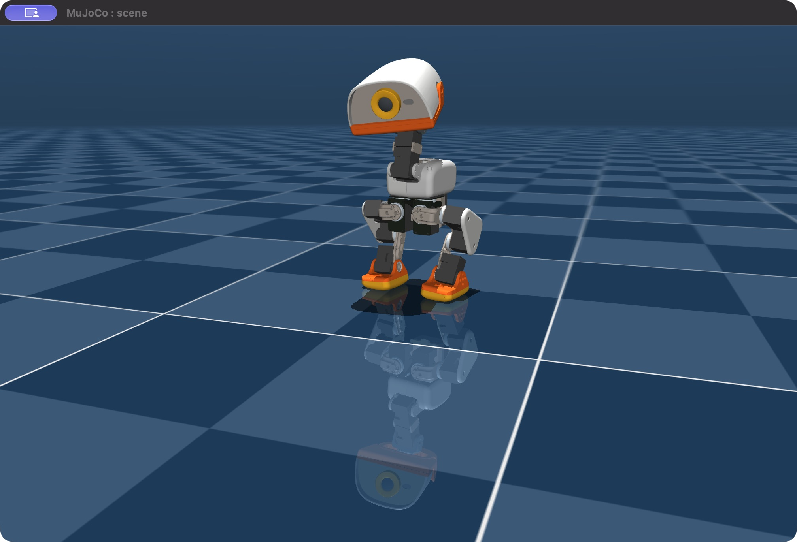
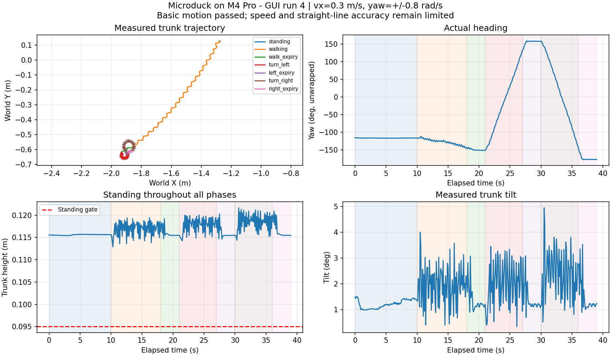

# MacBook Pro M4 模擬器驗證結果

日期：2026-11-06（Asia/Taipei）。測試範圍：本機 CPU MuJoCo 物理模擬、官方 ONNX 策略、真實 robotd 控制迴圈及原生視窗。

## 判定

**環境搭建完成；指定操作點的基本站立、行走、左右轉向與命令逾時測試通過。低速穩定性、速度追蹤及直線精度尚未通過完整驗收。**

這是可供下一階段橋接開發的模擬基線，並非所有速度／初始狀態都已正常。V7RC APP 尚未連線；本次沒有訓練新模型或測試實體機器人。

## 環境與方法

- MacBook Pro，Apple M4 Pro，48 GB RAM，macOS 27.0.1，arm64。
- runtime main `98ce17e4868ba9370713c4d11f3d934e5a1b7687`；RL develop `bae39f5900b318f7e87fc485c30a31213cfa14eb`，兩個上游倉庫追蹤檔案皆未修改。
- Python 3.12.16、Rust 1.94.1、MuJoCo 3.10.0、ONNX Runtime 1.24.4，官方策略 v8；場景 `scene_backlash.xml`。
- 有原生 MuJoCo 視窗，單隻 duck，無相機、無容器、無 DB、無 GPU 訓練。
- 以 JSON-RPC `robot.move` 控制官方 robotd；透過獨立 TCP 連線讀取 MuJoCo 的真實 trunk 位置與 IMU 姿態，避免以「命令已接受」或估計里程作為成功證據。
- 最後一輪每秒約 10 次取樣，397 筆物理感測紀錄、46 筆 daemon health。轉向角度逐筆 unwrap 累加，可記錄超過 180° 的轉動。
- [環境、套件與策略 SHA-256](evidence/2026-11-06/environment.json)、[可重現安裝及操作](../microduck/local-simulator-macos.md)。

## 指定操作點的完整測試

gui-run-4 開始於本地時間 **13:20:04**，精確時間以 [summary.json](evidence/2026-11-06/gui-run-4/summary.json) 的 UTC `started_at` 為準。

| 項目 | 命令／時間 | 實測 | 判定 |
| --- | --- | --- | --- |
| 持續站立 | 零速度，10 秒 | 平面位移 5.1 mm；最低軀幹高度 0.1154 m；最大傾斜 1.51° | 通過基本站立 |
| 行走 | vx=0.3 m/s，8 秒 | 平面淨位移 0.924 m；起始朝向投影前進 0.901 m；偏航 −28.7° | 通過基本前進；直線與速度精度有限 |
| 左轉 | vyaw=+0.8 rad/s，6 秒 | 累積轉角 +284.6°，平面位移 3.47 cm | 通過正向轉動 |
| 右轉 | vyaw=−0.8 rad/s，6 秒 | 累積轉角 −300.3°，平面位移 3.46 cm | 通過反向轉動 |
| 行走後輸入逾時 | 3 秒不送移動命令 | 最後一秒平面漂移 0.55 mm | 通過收斂門檻 |
| 左轉後輸入逾時 | 同上 | 最後一秒平面漂移 0.70 mm | 通過收斂門檻 |
| 右轉後輸入逾時 | 同上 | 最後一秒平面漂移 0.39 mm | 通過收斂門檻 |

整輪最低軀幹高度約 **0.1129 m**、最大傾斜 **4.95°**；模擬時間倍率介於 **0.9991–1.0049×**。46 筆 health 全為 healthy，達成頻率 **49.819–50.184 Hz**，missed ticks 為 **0**。

本次基本門檻：軀幹高度 >0.095 m、傾斜 <30°、即時倍率 0.95–1.05×、daemon healthy；前進須 >0.30 m 且 >請求理想距離的 25%（本輪實際門檻 0.60 m）；轉向須朝正確方向超過 30°。這些門檻僅確認可操作與保持直立，不代表速度追蹤、停止距離或轉角精度合格。

逾時階段不再送移動命令；robotd 日誌記錄 intent 超過約 500 ms 後歸零。機器人仍會在歸零前與收斂期間移動／轉動，本輪行走逾時階段共移動 7.7 cm，左右轉後分別再轉約 +25.3°／−35.6°。不可將其描述為立即煞停。

另從保存的物理樣本計算，三個逾時階段最後一秒的轉角依序為 −0.405°、−0.004°、−0.223°，可見平移與旋轉都已明顯收斂；此為事後量測，原驗證腳本的逾時通過條件只檢查末秒平面漂移。

上圖為本次第一輪的原生視窗截圖；不是生成圖。模型與資產來源為 Pollen Robotics 的 microduck_rl，STL 適用 [CC BY-NC-SA 4.0](https://creativecommons.org/licenses/by-nc-sa/4.0/)。

## 保留的失敗與限制

| 紀錄 | 結果與意義 |
| --- | --- |
| [gui-run-1](evidence/2026-11-06/gui-run-1/summary.json) | 0.15 m/s 前進 8 秒有 0.581 m 位移，但之後因背景服務生命週期中斷而 Broken pipe，未完成轉向，不計為整輪通過。新增 serve 持續模式後不再出現該中斷。 |
| [gui-run-2](evidence/2026-11-06/gui-run-2/summary.json) | 相同 0.15 m/s 前進只有 6.2 mm，基本行走失敗；runtime healthy／即時速度不能證明有走路。 |
| [gui-run-3](evidence/2026-11-06/gui-run-3/summary.json) | 0.3 m/s 前進 0.926 m，但 +0.5 rad/s 左轉只達 +14.3°，未達門檻；右轉 −0.5 rad/s 可達 −223.2°。左右／低速表現不一致。 |
| [gui-run-4](evidence/2026-11-06/gui-run-4/summary.json) | 調整為 vx=0.3、vyaw=±0.8 後整輪基本動作通過。這是調整操作點，沒有修正策略或模擬致動器，也不能消除前面揭露的問題。 |

第四輪前進的淨速度約 0.115 m/s，低於 0.3 m/s 請求；轉向亦有超轉與收斂漂移。官方 [simulation design §11](https://github.com/pollen-robotics/microduck/blob/98ce17e4868ba9370713c4d11f3d934e5a1b7687/docs/design/simulation.md) 已記錄前進速度不足，並指出 body server 使用 XML position actuators，而非訓練時 BAM actuator。這是值得追查的上游差異，**本次未證明它是本機低速失敗的唯一原因**。

因此本次可宣稱「指定條件下的基本模擬操作可用」，不能宣稱「所有搖桿速度皆平順」或「實機速度與模擬完全一致」。下一階段 V7RC 橋接應先使用上述操作點，另外將低速與精度列入獨立追蹤；不要以更改封包比例掩蓋模擬器限制。

## 證據與重跑

- 各輪的 `samples.jsonl` 為逐筆物理量、`health.jsonl` 為 daemon 回覆、`console.log` 為結果／錯誤輸出。
- [最後一輪完整摘要](evidence/2026-11-06/gui-run-4/summary.json)、[啟動紀錄](evidence/2026-11-06/startup.log)、[robotd 紀錄](evidence/2026-11-06/robotd.log)、[MuJoCo body 紀錄](evidence/2026-11-06/body.log)。
- 複驗指令：在已啟動的模擬器旁執行 `microduck_rl/.venv/bin/python scripts/verify-simulator.py --output .runtime/validation-new-run`，約 39 秒。`--walking-speed`／`--turning-speed` 可測其他操作點，失敗會回傳非零狀態。
- 上游全 workspace 測試未執行；本次針對實際模擬功能驗證，已通過所需元件建置、Python 匯入與動作實測。

交付前已將模擬器重設為初始站立狀態並保留原生視窗，[最終 health](evidence/2026-11-06/final-health.txt) 為 healthy、約 50.1 Hz、0 missed。該輸出的電壓與溫度是模擬固定值，`zero3` 為軟體預設板型，不代表 Mac 或實體機器人的硬體量測；本機以一般程序執行，未安裝 Linux systemd units 或發布 release。

目前缺少拾起偵測模型（啟動警告），沒有驗收相機、聲音、真實 BLE／馬達、相依於 Linux 的網路功能、GPU 訓練或實機 sim-to-real。
