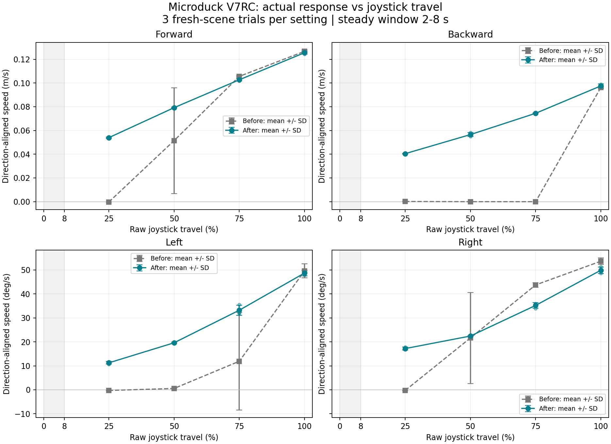

# VelStand v8 比例控制校正與 54 輪重測

正式測試時間為 2026-11-07T11:01:35+08:00 至 2026-11-07T11:23:22+08:00（Asia/Taipei）。以同一份 VelStand v8 ONNX、MuJoCo 平地場景、取樣方式、幅度、方向與亂數順序重測。

## 找到的原因

原始 54 輪的 requested 與 applied 都跟隨預期命令。以 75% 左轉為例，穩態命令是 +0.583 rad/s。能轉的一輪，膝關節目標在量測窗內擺動約 1.10 rad。幾乎不轉的兩輪只擺動約 0.034 rad。三輪的 `robotd` 策略標記皆為 `walk`。同一命令在這套策略與場景中可以落入站姿或步態，這解釋了起步表現為何不一致。[原始 54 輪](2026-11-07-proportional-control.md)

上游 VelStand v8 的訓練紀錄也指出，步態教師在低速原地轉向有兩種啟動結果，v8 在約 0.3 rad/s 仍呈現弱且不連續的轉向，左右反應不同。這與本機量測吻合。[VelStand v8 訓練紀錄](https://raw.githubusercontent.com/pollen-robotics/microduck_rl/bae39f5900b318f7e87fc485c30a31213cfa14eb/docs/velstand_policy.md)

本機探測中，先用一秒滿幅帶起步態，再回到原本 25% 左轉命令，可維持約 8°/秒。同樣方法對原本 25% 前進與後退的穩態命令效果有限。舊資料中的滿幅後退約在 1.5～2 秒之間開始持續移動。因此前後移動需要提高低幅度的穩態命令，後退也需要較長的起步輔助。對稱的轉向命令在步態啟動後仍有不同的實測速度，因此左右曲線分開校正。首版候選的 25% 右轉約 20°/秒，而左轉約 6°/秒。該批次作為探測資料，微調左右低幅後重新從第一輪開始，正式結果只包含最後一版。

## 控制調整

工作區的 `scripts/v7rc-bridge` 預設使用 `velstand-v8`。死區仍為 8%。前進、後退與左右轉採各自的分段插值。預設限幅下的穩態命令如下。

| 原始幅度 | 前進 m/s | 後退命令幅度 m/s | 左轉 rad/s | 右轉命令幅度 rad/s |
| --- | ---: | ---: | ---: | ---: |
| 25% | 0.102 | 0.185 | 0.220 | 0.165 |
| 50% | 0.145 | 0.220 | 0.365 | 0.210 |
| 75% | 0.213 | 0.260 | 0.583 | 0.420 |
| 100% | 0.300 | 0.300 | 0.800 | 0.720 |

從中立開始單軸運動時，橋接按搖桿幅度提供限幅內的起步輔助。前進和轉向維持 0.55 秒，再以 0.35 秒退回目標。後退維持 1.75 秒，再以 0.10 秒退回。右轉起步輔助上限為預設 0.66 rad/s，若穩態目標更高則直接維持目標。回中、失聯、重新連線會清除起步狀態。持續操作中的反轉與混合輸入沿用穩態曲線。可用 `--drive-profile linear` 重現原始映射。

## 相同 54 輪的穩態結果

每輪重新啟動場景、站穩後回中 4 秒，再以 20 Hz 送出固定 SRT。持續 8 秒，取第 2～8 秒的位移與偏航。每一組三輪。數字是預期方向的平均速度，微小負值代表反向漂移。

| 幅度 | 前進 m/s | 後退 m/s | 左轉 °/秒 | 右轉 °/秒 |
| --- | ---: | ---: | ---: | ---: |
| 25% | ≈0 → 0.054 | ≈0 → 0.040 | -0.3 → 11.3 | -0.3 → 17.2 |
| 50% | 0.051 → 0.079 | ≈0 → 0.057 | 0.6 → 19.6 | 21.6 → 22.4 |
| 75% | 0.106 → 0.103 | ≈0 → 0.074 | 11.9 → 33.2 | 43.7 → 35.2 |
| 100% | 0.127 → 0.126 | 0.096 → 0.098 | 49.6 → 48.7 | 53.6 → 49.9 |

有明顯持續運動的判定沿用 0.01 m/s 或 5°/秒。四個方向合計由 23/48 增至 48/48。其餘六輪為中立與死區邊界。

| 幅度 | 前進成功輪數 | 後退成功輪數 | 左轉成功輪數 | 右轉成功輪數 |
| --- | --- | --- | --- | --- |
| 25% | 0/3 → 3/3 | 0/3 → 3/3 | 0/3 → 3/3 | 0/3 → 3/3 |
| 50% | 2/3 → 3/3 | 0/3 → 3/3 | 0/3 → 3/3 | 2/3 → 3/3 |
| 75% | 3/3 → 3/3 | 0/3 → 3/3 | 1/3 → 3/3 | 3/3 → 3/3 |
| 100% | 3/3 → 3/3 | 3/3 → 3/3 | 3/3 → 3/3 | 3/3 → 3/3 |

| 幅度 | 校正前左右轉速差 °/秒 | 校正後左右轉速差 °/秒 |
| --- | ---: | ---: |
| 25% | 0.02 | 5.94 |
| 50% | 21.06 | 2.82 |
| 75% | 31.84 | 2.00 |
| 100% | 4.02 | 1.17 |

原始 25% 兩側都接近零，因此轉速差小。校正後兩側皆起步，但仍相差約 6°/秒。50%～100% 的左右轉速差則都縮小。

校正後有效輪數 54/54，穩態命令符合預期 54/54，跌倒中止 0 輪。即時倍率 0.9968～1.0033，最低控制迴圈頻率 48.90 Hz。

另以預設啟動入口完成 14 階段 UDP 回歸，涵蓋四軸映射、失聯回中、非中立封包無法重新解鎖及異常封包。隔離測試共執行 32 項，其中略過 1 項 Linux 專用測試。[UDP 回歸結果](evidence/2026-11-07-stick-calibrated/udp-regression.json)

## 起步段的代價

以下是 25% 幅度前兩秒內沿預期方向的累積位移或轉角。較大的數值反映機器人能從站姿進入步態，也反映起步輔助可能帶來暫時較快的動作。穩態曲線的改善需和這段反應一起解讀。

| 方向 | 單位 | 校正前 | 校正後 |
| --- | --- | ---: | ---: |
| 前進 | cm | 0.13 | 13.32 |
| 後退 | cm | 0.11 | 4.35 |
| 左轉 | ° | 3.97 | 38.77 |
| 右轉 | ° | 2.72 | 46.76 |

測試範圍為 Mac M4 的無視窗平地模擬，採本機 SRT sender。混合軸、低於 25% 的完整掃描、手機操作感及實機仍待各自量測。校正曲線適用本次固定的 VelStand v8 模型與模擬配置。

## 圖表與重現



- [校正後逐輪摘要](evidence/2026-11-07-stick-calibrated/summary.json)
- [校正後速度與變異 CSV](evidence/2026-11-07-stick-calibrated/response.csv)
- [校正後原始感測 JSONL gzip](evidence/2026-11-07-stick-calibrated/samples.jsonl.gz)
- [環境與來源雜湊](evidence/2026-11-07-stick-calibrated/environment.json)
- [比較數值](evidence/2026-11-07-stick-calibrated/comparison.json)

暫停手機與相機連線、停止其他模擬器後，從整合 Repo 根目錄使用新的輸出目錄執行。

```sh
microduck_rl/.venv/bin/python scripts/measure-stick-response.py   --drive-profile velstand-v8 --output .runtime/stick-response-calibrated-new
microduck_rl/.venv/bin/python scripts/summarize-stick-response.py   .runtime/stick-response-calibrated-new/summary.json   --baseline-aggregate docs/validation/evidence/2026-11-07-stick-response/aggregate.json   --output .runtime/stick-response-calibrated-new/analysis
```
