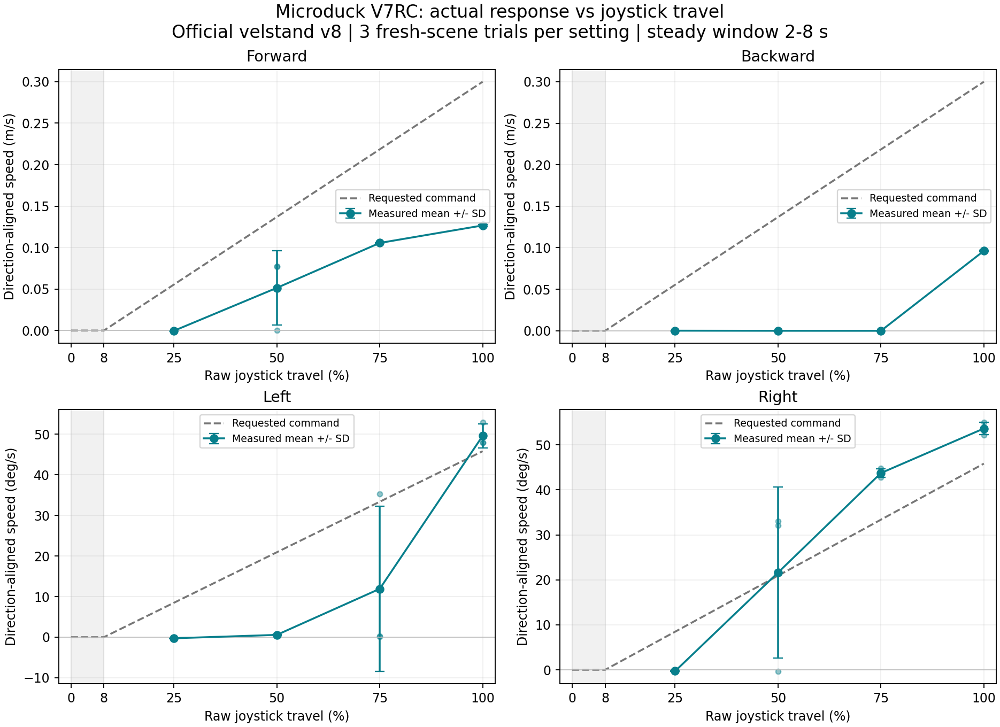

# 不同搖桿幅度的實際走速與轉向速度

本頁保留原始線性映射的基線。後續對同一模型與試驗條件完成方向校正和重測。[校正後的 54 輪對照](2026-11-07-proportional-control-calibrated.md)

測試日期：2026-11-07，Asia/Taipei；正式量測 2026-11-07T10:17:16+08:00 至 2026-11-07T10:38:55+08:00。

## 結論

橋接層是扣除 8% 死區後的線性比例映射，正式 54/54 輪的 robotd requested 與預期相符。穩態各輪的平均 applied 與預期命令最大差 6.97e-12（各軸原單位）。但實際動作不是理想線性比例，且前後與左右並不對稱。

- 前進：中高幅度啟動後有速度分級，低幅度幾乎不動；50% 有未起步的輪次，滿幅實際速度低於 0.3 m/s 命令。
- 後退：本次 25%～75% 幅度幾乎沒有持續後退，100% 才有明顯反應，不能視為全幅度平滑比例。
- 轉向：25% 幾乎不轉；50% 左右反應不對稱，較大幅度才有明顯分級。須分開看左、右曲線。
- 此結論僅涵蓋固定官方策略、平地與本次參數；三次重複反映相同條件下的重現性，不代表不同地形、隨機初始條件或真實機器人的統計驗收。

本次只量測，**沒有修改橋接增益、死區、最大速度、官方策略或 APP**。觀察到的死區是動作表現，並未確認其內部成因；不能直接宣稱 ONNX 不支援後退或把調大增益當成已驗證修正。

## 環境與版本

- Mac M4 Pro／arm64，CPU MuJoCo，即時物理模擬，`scene_backlash.xml`。
- Runtime `98ce17e4868ba9370713c4d11f3d934e5a1b7687`；RL `bae39f5900b318f7e87fc485c30a31213cfa14eb`；整合程式基線 `2aff421668ddad2bdb552f26bd9d5d4c04802094`。量測與彙整腳本為本次新增，實際來源 SHA256 見 environment.json。
- 官方 seed-v8 `velstand.onnx` SHA256：`2fc7f8ee6acd7d0d3f66a99927b5d5a56589aeed02ec714de329b252d5ccf492`。
- 與本機已安裝 preview.2 比對，`bridge/v7rc_udp.py` 及 `velstand.onnx` 的 SHA256 相同。
- 沿用真實 SRT UDP → bridge → robotd → MuJoCo 控制路徑。手機已暫停，sender 為本機 127.0.0.1，測試橋接只允許該來源，無手機／實機控制。
- `DUCK_SIM_VIEWER=0`、`MICRODUCK_VIDEO=0`，排除視窗與相機渲染負載；因此不代表開啟影像時的效能或 Wi-Fi 延遲驗收。
- 穩態模擬／實際時間倍率 0.9966～1.0034，daemon 最低 loop Hz 46.92。

## 方法與判定

1. 25%、50%、75%、100% 原始搖桿幅度，分別測前進、後退、左轉、右轉；另測中立與 8% 死區邊界，各三次，共 54 輪。幅度定義為 `abs(PWM - 1500) / 500`，以固定 SRT 碼測試，不量測 APP 觸控行程。各重複區塊內方向／幅度隨機排序，seed=20261107。
2. **每一輪重新建立場景與 daemon**，等待官方 up 的完整起立流程結束，再持續送中立 4 秒；量測前檢查軀幹高度 >0.095 m、傾斜 <20°。正式初始軀幹高度 0.1154～0.1155 m。
3. SRT 每秒 20 包，物理感測每秒約 20 次。移動命令持續 8 秒，排除最初 2 秒，以後續約 6 秒作為穩態量測窗。
4. 走速使用相鄰感測位置差，投影到該段中點機身朝向後積分，再除以模擬秒數。這可避免轉彎時只投影到起始朝向造成錯估；同時保留橫移與每實際秒速度。
5. 轉速用 IMU quaternion 計算 yaw，對相鄰角度 unwrap 後累加，再除以模擬秒數；不是只拿首尾角度相減，因此轉超過 180° 仍可正確量測。
6. 有效穩態樣本需完整完成、軀幹高度 >0.095 m、全程傾斜 <30°、命令映射相符、loop >=45 Hz、穩態窗至少 5.5 模擬秒、時間倍率 0.95～1.05。54/54 輪符合。即使速度很小或方向不符，也不會因此刪除樣本；跌倒等無效輪次則另列，不混入正常速度平均。
7. 表格為「平均 ± 三次樣本標準差（有效輪數／總輪數）」。前進、後退、左轉、右轉都以**預期方向為正**；微小負值表示反方向漂移。完整每輪結果及已套用命令保留於 JSON／CSV。

前置試跑曾在 health 已可用、官方起立流程尚未完成時過早取樣，初始坐姿被高度條件攔下。該資料不列入正式 54 輪；腳本已改成等待完整啟動並檢查站姿。這不是正式量測中的跌倒結果。

## 走速

單位 m/s。目標為扣除死區後的命令幅值；後退方向已轉正，不能把 drift 的絕對值當作成功後退速度。

| 原始幅度 | 目標速度幅值 | 實際前進 | 實際後退 |
| --- | --- | --- | --- |
| 25% | 0.0554 | -0.0003 ± 0.0000 (3/3) | 0.0001 ± 0.0000 (3/3) |
| 50% | 0.1370 | 0.0514 ± 0.0446 (3/3) | 0.0000 ± 0.0000 (3/3) |
| 75% | 0.2185 | 0.1056 ± 0.0005 (3/3) | -0.0001 ± 0.0000 (3/3) |
| 100% | 0.3000 | 0.1267 ± 0.0012 (3/3) | 0.0962 ± 0.0009 (3/3) |

## 轉向速度

單位 °/s。右轉方向已轉正。

| 原始幅度 | 目標轉速幅值 | 實際左轉 | 實際右轉 |
| --- | --- | --- | --- |
| 25% | 8.47 | -0.28 ± 0.00 (3/3) | -0.29 ± 0.00 (3/3) |
| 50% | 20.93 | 0.56 ± 0.02 (3/3) | 21.62 ± 19.00 (3/3) |
| 75% | 33.38 | 11.91 ± 20.31 (3/3) | 43.75 ± 0.99 (3/3) |
| 100% | 45.84 | 49.62 ± 2.92 (3/3) | 53.64 ± 1.41 (3/3) |

## 明顯持續運動的輪數

以預期方向的穩態平均速度 ≥0.01 m/s 或 ≥5°/s 區分「明顯運動」與接近站立漂移；此門檻用於解讀重複結果，不是產品驗收標準，也不會把未啟動輪次從速度平均中剔除。

| 幅度 | 前進 | 後退 | 左轉 | 右轉 |
| --- | --- | --- | --- | --- |
| 25% | 0/3 | 0/3 | 0/3 | 0/3 |
| 50% | 2/3 | 0/3 | 0/3 | 2/3 |
| 75% | 3/3 | 0/3 | 1/3 | 3/3 |
| 100% | 3/3 | 3/3 | 3/3 | 3/3 |

## 中立與死區

死區測試同時將 CH1／CH2 設為 1540，CH3／CH4 保持 1500，確認兩軸位於死區邊界時命令均為零。

| 條件 | 平均機身前向漂移 m/s | 平均 yaw 漂移 °/s | 輪數 |
| --- | --- | --- | --- |
| 中立 0% | -0.00024 | -0.062 | 3 |
| 死區邊界 8% | -0.00026 | -0.053 | 3 |

## 曲線與證據



虛線是目標命令，實線是實際平均，誤差棒為樣本標準差，小點為各輪數據。曲線未做增益補償或為了看似線性而重新縮放。

- [每輪完整結果](evidence/2026-11-07-stick-response/summary.json)
- [彙整 JSON](evidence/2026-11-07-stick-response/aggregate.json)、[速度 CSV](evidence/2026-11-07-stick-response/response.csv)、[每輪 CSV](evidence/2026-11-07-stick-response/trials.csv)
- [原始感測 JSONL gzip](evidence/2026-11-07-stick-response/samples.jsonl.gz)
- [環境與來源雜湊](evidence/2026-11-07-stick-response/environment.json)、[SVG 曲線](evidence/2026-11-07-stick-response/stick-response.svg)

## 重現與後續

確認手機已暫停，其他模擬器／橋接均已關閉；使用新的輸出目錄避免覆寫前次證據。從整合 Repo 根目錄執行：

```sh
microduck_rl/.venv/bin/python scripts/measure-stick-response.py \
  --output .runtime/stick-response-new-run
microduck_rl/.venv/bin/python scripts/summarize-stick-response.py \
  .runtime/stick-response-new-run/summary.json \
  --output .runtime/stick-response-new-run/analysis
```

量測結束會停止該次模擬器與橋接；重新從桌面圖示啟動，清除本機來源鎖定，四通道回中後再恢復手機。幾何與時間基準測試連同既有測試共 30 項，Mac 略過 1 項 Linux 專用測試，結果 OK。

後續若要改善操作感，應先研究低速／後退及左右不對稱的 runtime／策略原因，並以這份曲線作為調參或訓練前的基線；本次尚未實作閉迴路速度校正。較細幅度的啟動門檻、開影像負載、斜坡與實體機器人仍待另測。
